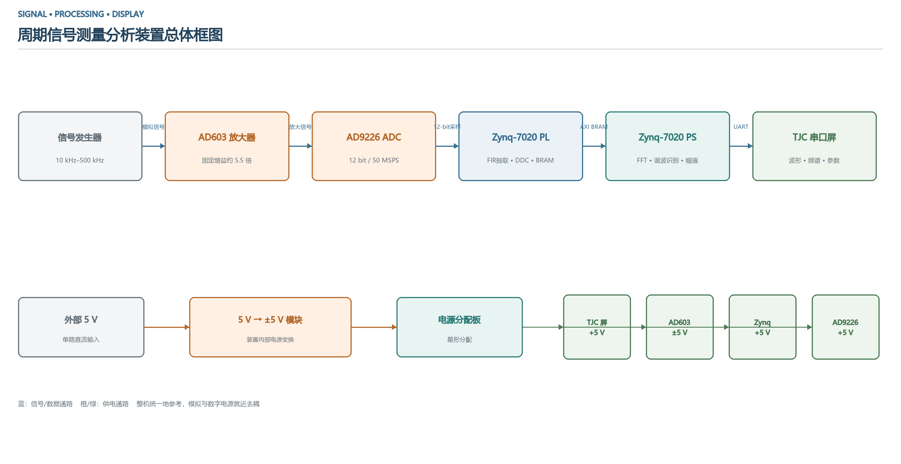

# 2026 安徽赛区电赛 G 题：周期信号测量分析装置（Zynq-7020）

基于 **XC7Z020CLG484-1**，以 PL 完成 ADC 采集、FIR 抽取、DDC 和 BRAM 缓存，以 Cortex-A9 完成 FFT、频谱分量识别、幅值测量、校准及陶晶驰串口屏交互。

> **主版本：`projects/2026_FIR/`，应用源码最后修改于 2026-08-07。** 仓库名沿用早期 `7020_BRAM_ADC`，根目录原来的 4 月 ADC 示例已归档。此次整理保持测量算法和 RTL 行为，仅收集依赖、修正发布路径、清理生成物并补充说明。

本项目参加 **2026 年安徽赛区电赛 G 题「周期信号测量分析装置」**。参赛赛区由作者确认；硬件与系统细节参考作者提供的设计报告，报告参考版文件修改于 2026-08-03，当前主版本应用源码修改于 2026-08-07。

报告方案采用 **AD603 前端放大（标称约 5.5 倍）＋ AD9226 12 位 ADC（50 MSPS）＋ Zynq-7020 ＋ 7 英寸 TJC 串口屏**。查看 [设计报告参考与版本差异](docs/report-reference.md)，其中包含总体框图、前端电路图、PL 框图和屏幕布局。



仓库提供源码与报告参考资料，未包含可编辑模拟前端/PCB、完整 HMI 或正式报告原件；报告中的历史测试记录与本轮复现验证分别注明，不据此宣称题目全部指标或获奖成绩。

## 从这里开始

1. 阅读 [设计报告参考](docs/report-reference.md)和 [版本与来源](docs/versions.md)，确认使用最新 FIR 版。
2. 阅读 [复现步骤](docs/build.md)，使用 Vivado / Vitis **2025.2**。
3. 接线前核对 [硬件与寄存器](docs/hardware.md)和主版本 XDC。
4. 串口屏按 [屏幕接口](docs/screen.md)创建控件与按键协议。
5. 查看 [验证记录与限制](docs/validation.md)。

## 目录

| 目录 | 用途 |
|---|---|
| `projects/2026_FIR/` | 主版本：FIR 抽取 + FFT/DDC + 测量/校准 UI |
| `archive/2026/` | 7 月非 FIR 前端版本，保留最终本地应用快照 |
| `archive/7020_BRAM_ADC/` | 4 月单 ADC + BRAM + FFT 基础版 |
| `ip_repo/AXI_Lite_PS_To_PL_PL_1_0/` | 三个版本使用的自定义 AXI-Lite IP 源码与驱动 |
| `scripts/` | Vivado 准备/构建和静态资料检查工具 |
| `docs/` | 复现、接线、协议、验证和来源记录 |

## 主版本数据链路

```text
ADC1 (12 bit, offset binary, 50 MHz)
  → FIR Compiler (40 倍抽取，1.25 MS/s)
  → 原始抽取数据 / DDC I-Q 结果 → BRAM → PS
PS: 4096 点 FFT → 峰值/谐波筛选 → DDC 幅值测量
  → 校准与显示缓存 → UART0 → TJC 串口屏
DDS / DAC 用于激励、调试与校准，具体路径由控制寄存器选择。
```

源码包含测量/校准两种模式、波形/频谱两种视图、1/3 周期显示，最多 5 个分量；频率结果使用 500 Hz 栅格。PL 的采集深度是 16384 点，与 PS 的 4096 点 FFT 长度不同。

**已知算法边界：** 显示波形和总 Vpp 根据各频谱分量以零相位重构，没有恢复相对相位；任意相位多音信号的真实波形及 Vpp 不能由此保证。量程、增益与校准常数依赖实际模拟前端，不能直接迁移到另一套硬件。

## 开源

原创部分采用 [MIT](LICENSE)；CMSIS 和 AMD 内容见 [第三方声明](THIRD_PARTY_NOTICES.md)。保留历史提交，主分支不再跟踪缓存、BSP、实现结果、IDE 日志或烧录文件。原始本地工程未改动。
