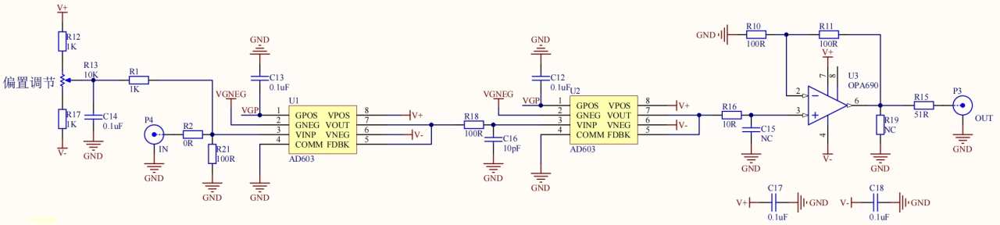
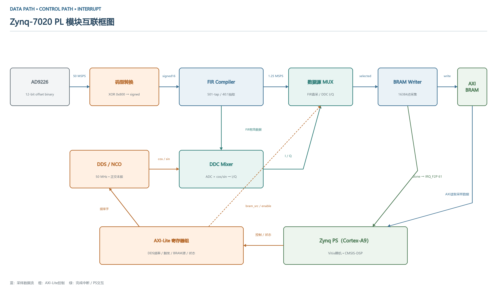
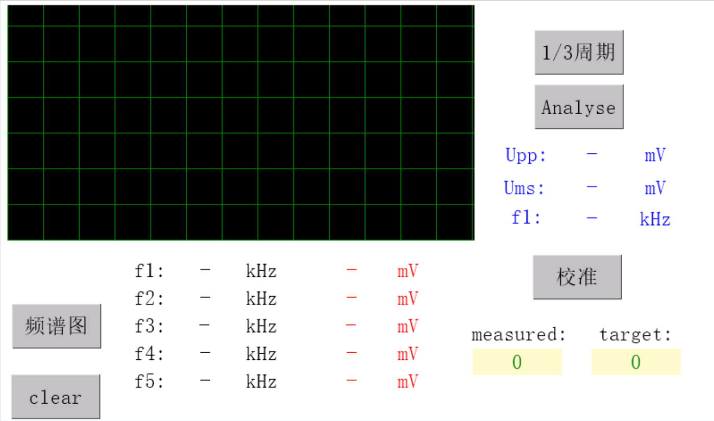

# 安徽赛区设计报告参考

## 来源与适用范围

项目作者确认：本项目参加 2026 年安徽赛区电赛 G 题「周期信号测量分析装置」。本文参考作者提供的《G题设计报告_框图流程图完整版 - 副本 (2).docx》，文件修改时间为 2026-08-03 15:53:43；主版本软件文件修改于 2026-08-07。报告是方案和历史测试记录的参考来源，主版本的现行行为以仓库源码为准。

本次提取技术图片并编写参考摘要，不发布原 DOCX，也不将其中的编辑者元数据收入仓库。原文件 SHA-256：`2d9c0da3e1720319ffc816b98aa5436fbad3bbcfc5c0d0bdf9c2ef14d22d1eeb`。

## 整机方案

| 部分 | 报告说明 | 源码或资料核对 |
|---|---|---|
| 模拟前端 | BNC 输入、AD603 放大，标称约 5.5 倍，电平移位后送 ADC | 前端图为两级 AD603 + OPA690；具体板级增益、偏置与端接需结合实物核对 |
| ADC | AD9226，12 位，工作采样率 50 MSPS | RTL 为 12 位 offset-binary 输入，系统时钟 50 MHz |
| FIR | 抗混叠低通、40:1 抽取 | 恢复的 `500000D.coe` 实际为 501 个系数，即 501 taps / 500 阶；XCI 为 40 倍抽取 |
| 数字处理 | 1.25 MSPS 数据、4096 点 FFT、谐波投票、DDC 测幅 | 与主版本主链路对应；每帧 16384 点、每分量 14 次，去掉最大/最小后平均 |
| 屏幕 | 7 英寸 TJC，UART 115200，500 点波形组件 | 驱动与控件名已收入源码，未取得匹配的可编辑 HMI |
| 供电 | 外部单路 5 V，内部变换并分配电源 | 缺完整电源设计，不能由框图推断各芯片电源引脚接法 |

### 总体框图

下方供电链是原报告示意，不是逐级串联供电的接线图；各模块应按实际供电和地参考设计核对。

### 模拟前端原图

此图来自报告图 3-1，仅提供位图参考，不等同于已核验的板级原理图或 PCB。报告文字的“固定约 5.5 倍”与图中两级放大结构需要结合模块配置和实测解释。

### PL 数据链路

DDC 混频位于 PL，I/Q 结果写 BRAM；对一帧 I/Q 求均值和计算幅度的操作位于 PS 的 C 程序。报告“混频后积分”的描述不应理解为现有 `ddc_core.v` 内含独立积分器。

### 屏幕布局

## 报告与当前代码的差异

| 项目 | 报告参考版 | 8 月 7 日主版本 |
|---|---|---|
| 测量触发 | msg=2 运行一次测量，msg=3 运行频谱流程 | 上电进入连续测量；按键 2 保持测量模式，按键 3 切换显示缓存视图 |
| 校准 | 描述两阶段，24 个 ADC 电压点和 22 个前端电压点 | `CAL_STEPS=13`，信号源端 0～240 mVpp、20 mV 步进；每档等待旧系数估值进入窗口，采集 8 次并拟合，合格后更新内存系数 |
| 增益换算 | 分阶段显式乘除约 5.5 倍 | `cal_k` 已合并前端增益，`(mag + cal_b) / cal_k` 直接得到信号源端 Vpp，不能重复除以 5.5 |
| 总 Vpp | 描述从 ADC 直采、多次测量求平均 | 当前屏显 t3 由各分量以零相位叠加合成后求峰峰值 |
| 频率 | 报告列 FFT 频点间隔约 305 Hz，摘要写不大于 350 Hz | FFT bin 间隔是 1.25 MHz / 4096 ≈ 305.18 Hz；输出频率另按 500 Hz 栅格取整，二者不可混为测频误差 |
| FIR 阶数 | 混用“501 阶”和“501-tap” | COE 可核对为 501 taps，对应 500 阶 |
| 清屏 | 界面图含 clear | 当前按键处理只实现 1～4，未发现独立 clear 操作 |

校准参数目前是运行时变量，成功校准后更新内存；没有找到将新参数写入非易失存储的路径，不能据报告的“固化”说法推断重启后保留。

## 报告测试记录

报告给出了单频示例：10、187.5、200、422.5、500 kHz，50～250 mVpp 范围中的若干测试点，表中 Vpp 偏差为 0～1 mV，完成时间记为不超过 2 s。还给出了 80/160/400 kHz、95.5/286.5/477.5 kHz 等多音组合及带外分量的记录。这些是报告中的历史数据，本轮未重复测试。

报告摘要或论证提到单次约 1.9 s、FFT 不超过 15 ms、阻带不低于 68 dB；仓库没有配套计时日志、滤波响应报告和完整原始测量记录，不能将这些值视为本轮验证结果。报告部分结果分析仍使用“预期”措辞。

多音表格需复核：例如 79/79/60 mVpp 的三个正弦分量按平方和换算 Vrms 约为 44.8 mV，与报告同组的 35 mV 不一致；80/51/60 mVpp 对应约 39.7 mV，与报告的 49 mV 也不一致。尚无原始波形和仪器设置可解释，因此这里不据报告宣称所有指标通过。

报告给出的多音抗干扰示例中，带外分量为 34 或 60 mV，不能替代完整的 200 mVpp 干扰工况验证。数字 FIR 的抑制作用也不能替代对 ADC 原始 50 MSPS 采样前的模拟带宽、过载与混叠检查。

源代码功能和本轮验证范围见 [验证记录](validation.md)。
